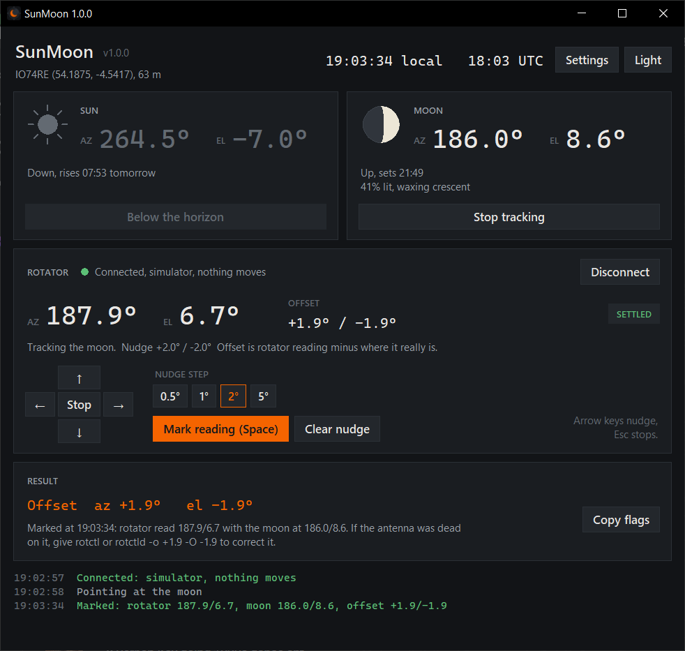

# SunMoon

Points the antenna at the sun or moon through hamlib's `rotctl.exe`, so you can check the
rotator calibration against the two things in the sky whose position is known to a fraction of
a degree. Nudge until it's dead on, mark it, and it tells you the offset and the `rotctl` flags
that correct it.



Windows. Installed at `C:\Radio\sunmoon\SunMoon.exe`, with shortcuts on the Desktop and in the
Start menu.

## Using it

**Close OscarWatch first** (or HRD Rotator, or any rotctld). They hold the rotator's port, and
SunMoon will tell you so if one of them has it. **Disconnect** hands the port back without
closing SunMoon.

1. Wait for a clear day with the sun well above the trees. Press **Point at the sun**. It slews
   there and keeps tracking.
2. Check it's really on the sun. By eye, the boom's shadow shrinks to a dot. By ear, sun noise
   peaks on the receiver. That's faint on 2 m and much easier on 70 cm and up.
3. Nudge with the arrow keys (or the buttons) until it's dead on. Pick a bigger step if 1 degree
   nudges don't shift it: the GS-232B seems to ignore moves of about 2 degrees or less.
4. Wait for **SETTLED**, then press **Space** (or **Mark reading**).
5. The result panel shows the offset and the flags, e.g. `-o +1.9 -O -1.9`. **Copy flags** puts
   them on the clipboard.

The offset is the rotator's reading minus where the sun really is. hamlib adds `-o`/`-O` to every
position it sends and subtracts them from every reading (checked in `src/rotator.c`), so the
flags it gives you are the right way round for rotctl and rotctld. OscarWatch's own offset
setting may apply it the other way round, so do one test move before trusting it there.

The moon works the same way. It's far too faint to hear on 2 m, so it's a by-eye check, or use a
camera strapped to the boom.

| Key | Does |
| --- | --- |
| Arrow keys | Nudge azimuth and elevation |
| Space | Mark the reading, once it says SETTLED |
| Esc | Stop the rotator and stop tracking |

Practising without moving anything: in **Settings**, pick model **1 Simulator (hamlib dummy)**.

## Settings

Everything is in the **Settings** window and saved to `sunmoon.json` next to the exe. The
defaults match this shack: Yaesu GS-232B (hamlib model 603) on COM8 at 9600 baud, IO74RE, 63 m.

| Setting | What it's for |
| --- | --- |
| Model | hamlib rotator model. Type any number `rotctl -l` lists. For a running rotctld use model 2 and port `127.0.0.1:4533` |
| Port | Serial port. The list shows the chip behind each one (FTDI, CP210x) so you don't pick the radio |
| Azimuth-only | Elevation is sent as 0 and the up and down nudges go away |
| rotctl.exe | Found automatically under `C:\Radio\hamlib*` if the saved path goes missing |
| Latitude and longitude | Beat the grid square's centre. Leave both blank to use the grid |
| Lowest elevation | Won't point below this. Set it above your trees and roofs |
| Deadband | Only re-commands once the target has moved this far, to spare the motors |
| Refraction | Lifts elevation for the atmosphere: half a degree at the horizon, nothing above 10 degrees |

## Accuracy

Sun and moon positions use Paul Schlyter's method with the main lunar perturbations, plus the
moon's parallax (up to a degree, the term that matters). Checked against PyEphem at 4,000 random
times across 2025 to 2027, from IO74RE:

| | Mean | Worst |
| --- | --- | --- |
| Sun | 0.008 deg | 0.014 deg |
| Moon | 0.03 deg | 0.10 deg |

Rise and set agree with PyEphem to within 2 seconds, and the moon's lit fraction to within 0.3%.
Any rotator reads back far coarser than this.

## Two hamlib quirks it works around

- **`rotctl -` is broken in the Windows 4.7.0 build.** It reads stray NUL commands and ignores the
  `+` prefix. SunMoon runs rotctl in plain interactive mode over a pipe instead, and waits for the
  `Rotator command:` prompt that ends every reply.
- **The GS-232B's move-then-read race.** hamlib sends `W183 009` plus a bare CR, and the controller
  answers with a CR that sometimes lands after hamlib's input flush. A position read straight
  after a move then gets one byte and fails with `Protocol error`. Measured on COM8: 9 reads in 20
  fail straight after a move, none with a half-second wait. SunMoon waits half a second after each
  move and retries a failed read.

## Building

```
pwsh -File build.ps1              build, install to C:\Radio\sunmoon, make the shortcuts
pwsh -File build.ps1 -NoInstall   build only
```

The first build creates a venv with PyInstaller and Pillow in `%LOCALAPPDATA%\sunmoon-build`,
outside OneDrive. The program itself is standard-library Python: `sunmoon.py` is the engine
(ephemeris, the rotctl driver, settings), `sunmoon_gui.py` is the window, and
`assets/make_icon.py` draws the icon.

`sunmoon.py` also works on its own from a terminal:

```
python sunmoon.py where          sun and moon az/el and rise/set, no rotator
python sunmoon.py sun            track the sun, arrow keys nudge, Space marks
python sunmoon.py moon --once    point, wait for it to settle, report, exit
python sunmoon.py sun --dummy    against hamlib's simulator
```
