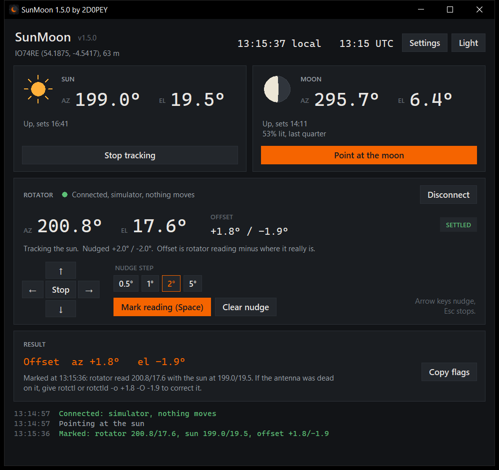

# SunMoon

**Easy calibration of your rotator using the sun or moon.**

SunMoon points your antenna at the sun or moon through hamlib, keeps it tracking, and lets you
nudge it with the arrow keys until it's dead on. Mark the reading and it tells you how far out
your rotator is, plus the `rotctl` flags that correct it.

Why the sun and moon? They're the only things in the sky whose position you can know to a
fraction of a degree, from anywhere, on any day, with no other kit. If your rotator says 180
and the sun is at 183, your rotator is 3 degrees out.



## Download

Everything is on the [latest release](https://github.com/JavierIOM/sunmoon/releases/latest).
You'll need a rotator and controller that hamlib supports: Yaesu GS-232A/B, SPID, Easycomm and
[plenty more](https://github.com/Hamlib/Hamlib/wiki/Supported-Rotators), or a rotctld already
running.

### Windows

1. Grab `SunMoon-<version>-win64.zip`.
2. Unzip it anywhere and run `SunMoon.exe`. Nothing to install. Windows 10 or 11, 64-bit.

hamlib comes in the zip. SunMoon drives your rotator through hamlib's `rotctl.exe`, and a copy of
it (version 4.7.0) sits in the `hamlib-w64-4.7.0` folder next to `SunMoon.exe`. If you've
installed a newer hamlib yourself, SunMoon finds that and uses it instead.

**Windows will probably warn you the first time** ("Windows protected your PC"), because the exe
isn't code-signed. Click **More info**, then **Run anyway**. That's normal for hobby software
off GitHub.

### Linux

For Debian, Ubuntu, Mint and Raspberry Pi OS, on a PC or a Pi alike. Grab
`sunmoon_<version>_all.deb`, then:

```
sudo apt install ./sunmoon_<version>_all.deb
```

apt installs hamlib (`libhamlib-utils`) and Tk along with it. SunMoon is then in your
applications menu, or run `sunmoon`.

Linux only lets members of the `dialout` group open serial ports. If SunMoon says so, run
`sudo usermod -aG dialout $USER`, then log out and back in. Raspberry Pi OS's first user is
already in it.

Other distros: install hamlib and Tk from your package manager (Fedora:
`sudo dnf install hamlib python3-tkinter`, Arch: `sudo pacman -S hamlib tk`), clone this repo
and run `python3 sunmoon_gui.py`.

The Linux version is tested on Ubuntu 22.04 and 24.04, on Intel and ARM, against hamlib's
simulator. Nobody has driven a real rotator with it yet, so tell us how you get on.

### macOS

For macOS 11 (Big Sur) and later, Apple Silicon and Intel alike. Grab
`SunMoon-<version>-macos.dmg`, open it, and drag SunMoon onto Applications. rotctl is built
into the app, so there's nothing else to install, Homebrew included.

**macOS will stop it the first time**, because the app isn't notarised (that takes a paid Apple
developer account). Open it once and click **Done** on the warning. Then go to **System
Settings > Privacy & Security**, scroll down to the line about SunMoon, and click **Open
Anyway**. On macOS 14 and earlier, right-click the app and choose **Open** instead. Either way
it's once only.

The rotator's port shows up as something like `cu.usbserial-DJ00ABCD`.

The Mac version is tested on macOS 14 and 15, Apple Silicon and Intel, against hamlib's
simulator. Same as Linux: tell us how you get on with a real rotator.

## First run

SunMoon asks for:

- **Your location:** your grid locator, or latitude and longitude if you want it exact, or
  [let a GPS find you](#let-a-gps-find-you).
- **Your rotator:** its hamlib model, the serial port (the list shows the chip behind each port,
  FTDI or CP210x, so you don't pick your radio by mistake) and the baud rate. On Linux the
  port is saved by its `/dev/serial/by-id` name, which stays put when `ttyUSB0` and `ttyUSB1`
  swap round at the next boot.

Close anything else that drives the rotator first (PstRotator, HRD Rotator, OscarWatch, Gpredict,
a rotctld). On Windows only one program can hold a serial port, and SunMoon will tell you if
something else has it. Linux lets two programs open it at once, and they garble each other's
commands, so close the other one. **Disconnect** hands the port back without closing SunMoon.

Want to try it without moving anything? Pick model **1 Simulator (hamlib dummy)**.

## Calibrating

1. Wait for a clear day with the sun well above the trees, and press **Point at the sun**. It
   slews there and keeps tracking.
2. Check it's really on the sun:
   - **By eye:** the boom's shadow shrinks to a dot, or the elements' shadows line up on the boom.
   - **By ear:** sun noise peaks on the receiver. Faint on 2 m, much easier on 70 cm and up.
3. Nudge with the arrow keys until it's dead on. If small nudges don't shift it, pick a bigger
   step: some controllers ignore moves of a degree or two.
4. Wait for **SETTLED**, then press **Space** (or **Mark reading**).
5. The result panel shows the offset and the flags, e.g. `-o +1.9 -O -1.9`. **Copy flags** puts
   them on the clipboard.

The offset is the rotator's reading minus where the sun really is. hamlib adds `-o`/`-O` to every
position it sends and subtracts them from every reading (see `src/rotator.c`), so the flags are
the right way round for `rotctl` and `rotctld`. Other programs' offset settings may work the
other way round, so do one test move before trusting them.

The moon works the same way. It's too faint to hear on most VHF setups, so it's a by-eye check,
or strap a camera to the boom.

| Key | Does |
| --- | --- |
| Arrow keys | Nudge azimuth and elevation |
| Space | Mark the reading, once it says SETTLED |
| Esc | Stop the rotator and stop tracking |

## Settings

All in the **Settings** window.

| Setting | What it's for |
| --- | --- |
| Grid locator, or latitude and longitude | Where you are. Lat/lon beats the middle of the grid square |
| Lowest elevation | It won't point below this. Set it above your trees and roofs |
| Deadband | Only re-commands once the target has moved this far, to spare the motors |
| Refraction | Lifts elevation for the atmosphere: half a degree at the horizon, nothing above 10 degrees |
| Model | hamlib rotator model. Any number `rotctl -l` lists. For a running rotctld use model 2 and port `127.0.0.1:4533` |
| Azimuth-only | Elevation is sent as 0 and the up and down nudges go away |
| rotctl | Found automatically. Windows: the one in the zip, or a newer hamlib you've installed. Linux: the distro's. macOS: the one inside the app. Browse to pick a different one |
| GPS port | An NMEA GPS to ask where you are, once at every start. Blank for none |

On Windows they're saved to `sunmoon.json` next to `SunMoon.exe`, or to `%APPDATA%\SunMoon` if
that folder is read-only (say you unzipped it into Program Files). On Linux they're in
`~/.config/sunmoon/sunmoon.json`, and on macOS in `~/Library/Application Support/SunMoon`.

## Let a GPS find you

Got an NMEA GPS on a serial port? SunMoon can ask it where you are, so there's nothing to type.
In **Settings**, pick it under **GPS port** and press **Get position**. After that SunMoon asks
once each time it starts, and updates your location if you've moved more than about 100 m. If
the GPS is off, or another program has the port, it says so and carries on with your saved
location.

Anything that sends GGA and RMC sentences will do, at 4800, 9600, 38400 or 115200 baud: SunMoon
works out which. It takes one fix and lets go of the port, and it only ever reads.

This is a convenience more than an accuracy gain. The middle of a six-character grid square is
already right to under a tenth of a degree, though the middle of a four-character one can be a
whole degree out. Height makes no measurable difference. If your computer's clock is 10 seconds
or more off GPS time SunMoon warns you, since a minute is a quarter of a degree, but it won't
change the clock.

Your position then shows in SunMoon's header to about 10 m, so mind that if you post a screenshot.

**With [OscarGPS](https://github.com/JavierIOM/OscarGPS):**

- **USB:** pick its port, labelled `CH340` on the usual board. This runs alongside OscarWatch on
  Bluetooth, as USB is a separate stream.
- **Bluetooth on Windows:** pick the port labelled `Bluetooth Incoming`, which is the one
  OscarGPS names on its screen. The board dials the PC, so give it 15 seconds. Only one program
  can hold that port, so it won't work while OscarWatch has it. Port numbers can change after
  a Bluetooth reset, so go by the label.
- **Linux and macOS:** use USB. OscarGPS's Bluetooth is built around Windows' Incoming ports.
  Its README has a Linux route, which shows up here as `rfcomm0`.

Linux doesn't lock serial ports, so if another program is reading the GPS, each gets only some
of the sentences. Close the other one first.

## Accuracy

Sun and moon positions use Paul Schlyter's method with the main lunar perturbations, plus the
moon's parallax (up to a degree, the term that matters). Checked against PyEphem at 4,000 random
times across 2025 to 2027:

| | Mean error | Worst |
| --- | --- | --- |
| Sun | 0.008 deg | 0.014 deg |
| Moon | 0.03 deg | 0.10 deg |

Rise and set times agree with PyEphem to within 2 seconds, and the moon's lit fraction to within
0.3%. Any rotator reads back far coarser than this.

## hamlib quirks it works around

- **`rotctl -` is broken in the Windows 4.7.0 build.** It reads stray NUL commands and ignores
  the `+` prefix. SunMoon runs rotctl in plain interactive mode over a pipe instead, and waits
  for the `Rotator command:` prompt that ends every reply.
- **The Yaesu GS-232B's move-then-read race.** hamlib sends `W183 009` plus a bare CR, and the
  controller answers with a CR that sometimes lands after hamlib's input flush. A position read
  straight after a move then gets one byte and fails with `Protocol error`. Measured: 9 reads in
  20 fail straight after a move, none with a half-second wait. SunMoon waits half a second after
  each move and retries a failed read.
- **Azimuth as -180 to 180.** Most rotators take 0 to 360 or more, but some are set up for -180
  to 180, and so is hamlib 4.3's simulator. Ask one for 182 and hamlib refuses with
  `range problem`. SunMoon sends the same direction a turn the other way, -178.
- **hamlib 4.3's serial errors** (Ubuntu 22.04) only say `serial_open return(-6)`, whether the
  port is missing or you're not in `dialout`. SunMoon checks the port itself first and tells you
  which.

## Building from source

Windows:

```
pwsh -File build.ps1              build, install to C:\Radio\sunmoon, make shortcuts, zip a release
pwsh -File build.ps1 -NoInstall   build and zip only
pwsh -File build.ps1 -InstallDir D:\Apps\SunMoon
```

Linux, on any Debian-family box:

```
sh packaging/linux/build-deb.sh   builds dist/sunmoon_<version>_all.deb
```

macOS, with the Xcode command line tools and [python.org's Python 3.13](https://www.python.org/downloads/macos/)
(the universal2 installer, which comes with Tk):

```
sh packaging/macos/build-app.sh   builds dist/SunMoon-<version>-macos.dmg
```

It builds rotctl from the Hamlib source for both Apple Silicon and Intel, static and without
the optional extras, so it needs nothing but macOS, then the app with PyInstaller around it.

The [Linux](.github/workflows/linux.yml) and [macOS](.github/workflows/macos.yml) workflows
build on every push and test what they built with `tests/smoke.py`: the `.deb` installed on
Ubuntu 22.04, 24.04 and 24.04 ARM, and the app on macOS 14 and 15, Apple Silicon and Intel.
That covers the rotctl driver against hamlib's simulator, the error messages, the command line
with and without a terminal, that the program finds its own rotctl, the window, and the GPS
reader against a pretend GPS, with screenshots saved as artifacts.

On Windows the first build makes a venv with PyInstaller and Pillow in `%LOCALAPPDATA%\sunmoon-build`, and
downloads the official `hamlib-w64-4.7.0.zip` and `hamlib-4.7.0.tar.gz` there, checking both
against the SHA-256 in `build.ps1`. The program itself is standard-library Python 3: `sunmoon.py`
is the engine (ephemeris, the rotctl driver, settings), `sunmoon_gui.py` is the window, and
`assets/make_icon.py` draws the icon.

Run from source, SunMoon uses whatever hamlib you've installed, since the bundled copy only
goes into the built program. `sunmoon.py` also works on its own from a terminal, using the same
`sunmoon.json` (installed from the `.deb` on Linux, it's `sunmoon where`, `sunmoon sun` and so on):

```
python sunmoon.py where          sun and moon az/el and rise/set, no rotator
python sunmoon.py sun            track the sun, arrow keys nudge, Space marks
python sunmoon.py moon --once    point, wait for it to settle, report, exit
python sunmoon.py sun --dummy    against hamlib's simulator
python sunmoon.py gps --device COM13    ask a GPS where we are, and save it
```

## Licence

SunMoon is MIT, see [LICENSE](LICENSE).

The Windows zip also contains `rotctl.exe` and its DLLs from [Hamlib](https://github.com/Hamlib/Hamlib)
4.7.0, unmodified, and the Mac app contains `rotctl` built from the Hamlib 4.7.0 source,
unmodified. Hamlib is a separate project and isn't covered by SunMoon's licence: the library is
LGPL and the programs are GPL. Its licence files are in the zip's `hamlib-w64-4.7.0` folder and
in the app's `Contents/Resources/hamlib-licence`. SunMoon only runs rotctl as a separate program
and talks to it over a pipe. The matching Hamlib source, `hamlib-4.7.0.tar.gz`, is attached to
every release that ships it.
